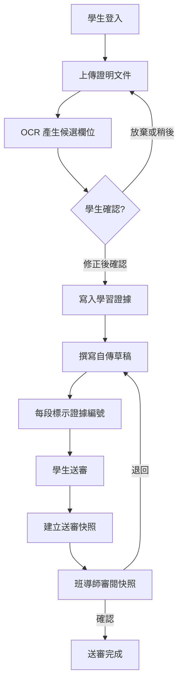
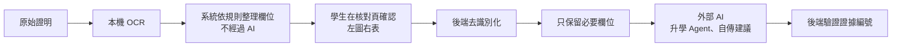
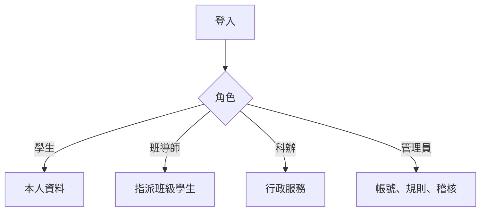

# 資管科智慧學習歷程系統－專題成果報告書（重寫版草稿）

> **文件狀態**：2026-10-16 重寫。V2 方向已於 2026-10-16 經指導老師與組員同意。
> **寫作原則**：只寫已經能被檢查的事實；尚未完成的功能、尚未驗收的外部服務、尚待決議的範圍，一律標示狀態，不寫成已完成。
> **對應資料**：流程圖放在同資料夾的 `流程圖/`；舊版報告書放在 `舊版/`；寫作過程的日誌放在 `寫作日誌.md`。

---

## 封面資訊

| 項目 | 內容 |
| --- | --- |
| 專題名稱 | 資管科智慧學習歷程系統 |
| 學校科系 | 康寧學校財團法人康寧大學 資訊管理科 |
| 專題生 | 111534105 田心于、111534107 張馨羽、111534124 林承諺 |
| 指導老師 | 李栢松 老師 |
| 文件日期 | 2026-10-16 |

---

## 摘要

學習歷程檔案的問題不只是資料太多，而是學生不知道從哪裡開始、哪些資料有用、哪些還缺。本專題以資訊管理科學生為對象，設計一套「五年學習歷程」系統：學生依年級查看自己的學習進度，上傳證明文件，經過辨識與人工確認後形成學習證據，再據以撰寫有依據的自傳草稿，最後由班導師確認送審版本。

系統的設計重點有三項：

1. **責任分工**：成熟的雲端服務（檔案儲存、文件協作）交給外部工具，本系統專注於五年脈絡、資料結構化、證據引用、缺件規則與教師確認。
2. **人工確認**：OCR 與 AI 只提供候選結果與建議，正式資料與送審內容一律由學生或教師確認。
3. **最小資料**：送往外部 AI 前，先移除姓名、學號、證號等非必要識別資訊。

截至 2026-10-16，系統的本機展示版已可操作四種角色的主要流程；OCR 已改為本機實際辨識（2026-10-28 更新），Google 服務的實機串接與 MySQL 實機驗收尚未完成。本報告會逐項標示這些狀態。

---

## 第一章 緒論

### 第一節 開發背景

資訊管理科學生在四年學習期間會累積成績、證照、競賽、實習與專題等資料。但多數學生是在升學或求職前才開始整理，資料散落在不同檔案與不同時間點，難以回頭證明某項成就與目標學校或科系的關係。

### 第二節 開發動機

- 新生不知道五年要做什麼、先做什麼。
- 學生想申請二技或其他升學管道時，常要在大量公告與資料夾中自行比對條件，過程令人感到混亂。
- 導師要審閱學生的自傳與資料，卻沒有統一的送審版本，難以確認內容是否與證據一致。

### 第三節 開發目的

1. 建立學生的五年學習路線，依年級顯示「現在該做什麼」。
2. 把證明文件轉成結構化資料，並保留可回查的來源。
3. 讓自傳的每一段都能指出它依據哪一筆證據。
4. 讓導師審閱固定的送審版本，而不是不斷變動的草稿。
5. 把 AI 限制在輔助角色，避免它決定資格、給分或發布規則。

### 第四節 與既有做法的差異

| 既有做法 | 本系統的做法 |
| --- | --- |
| 證明文件分散保存，靠學生自行整理 | 上傳後形成學習證據，每筆證據有固定編號 |
| 自傳由學生自行撰寫，無法確認依據 | 自傳段落標示引用的證據編號，學生可檢查 |
| 導師看到的是不斷修改的文件 | 導師審閱的是送審當時的快照，之後修改另存新版 |
| 升學條件查詢要逐份比對 | 缺件檢查與目標校系條件以規則列出，並標示來源 |

---

## 第二章 開發環境與工具

| 類別 | 項目 | 用途 |
| --- | --- | --- |
| 後端 | Python 3、Flask 3、Flask-SQLAlchemy、Flask-Migrate | 權限、業務規則、API、服務調度 |
| 資料庫 | MySQL 8.0（正式設定）；自動化測試使用 SQLite 記憶體資料庫 | 結構化業務資料 |
| 前端 | Jinja2 模板、純 HTML／CSS、少量 JavaScript | 學生端與教師端頁面 |
| 文件匯出 | python-docx | 備審資料 Word 檔 |
| AI | Google Gemini API（選用） | 自傳建議、資料整理；測試時一律使用假物件 |
| 測試 | pytest | 自動化測試 |
| 開發工具 | Antigravity IDE、Git、VS Code | 開發與版本控制 |

環境設定與移除清單記錄在 `docs/03_開發紀錄/01_參考與環境設定/`（以實際資料夾為準）。

---

## 第三章 系統規格書

### 第一節 使用者角色

本階段保留四種登入角色：

| 角色 | 主要工作 | 界線 |
| --- | --- | --- |
| 學生 | 查看五年路線、上傳證明、確認辨識結果、查看缺件、撰寫自傳、送審 | 只能操作本人資料；AI 草稿須由學生確認 |
| 班導師 | 查看本班進度、在自傳段落留言、確認送審版本 | 只能存取指派班級；只確認學生實際送審的版本 |
| 科辦／行政 | 電子證明、公告、表單 | 不因角色存在而取得備審內容審查權 |
| 系統管理員 | 帳號、規則、資料來源、AI 與 Google 設定、稽核 | 管理操作需留紀錄；不代替學生或教師確認內容 |

專任教師與專題指導教師在本階段不建立登入角色，資料庫保留關係欄位，待需求明確後再啟用。（見第七章 D1）

### 第二節 功能需求

| 編號 | 功能 | 說明 | 狀態（2026-10-16） |
| --- | --- | --- | --- |
| M1 | 登入與四種角色權限 | 依角色限制可見資料 | 本機展示版完成，正式帳號待驗收 |
| M2 | 五年學習路線首頁 | 顯示五年進度與下一步 | 本機展示版完成 |
| M3 | 上傳證明文件 | 保存檔案索引與分類 | 上傳介面完成；先存本機，Google Drive 以個人雲端硬碟測試中 |
| M4 | OCR 辨識 | 擷取課名、分數、證照等候選欄位 | 已改用本機 RapidOCR 實際辨識（2026-10-28），成績單與證照已用本機檔案實測；結果須學生在核對頁確認 |
| M5 | 欄位規則檢查 | 檢查分數範圍與格式 | 規劃中 |
| M6 | 學生確認 | 學生修正後才寫入正式資料 | 完成（本機） |
| M7 | 學習證據 | 已確認資料有固定證據編號 | 完成（本機） |
| M8 | 有依據的自傳草稿 | 段落標示來源；無效來源會被拒絕 | 完成（本機）；AI 為選用 |
| M9 | 導師確認送審版 | 送審時固定快照 | 完成（本機） |
| M10 | 刪除與保留 | 軟刪除、保留期限 | 保存期限待學校政策決定 |
| M11 | 操作紀錄 | 登入、確認、送審等紀錄 | 部分完成 |
| M12 | 失敗時回到人工流程 | OCR 或 AI 失敗不阻塞主線 | 部分完成 |
| M13 | 自傳歷史版本 | 可查看與比較舊版 | 存版完成；列表畫面待做 |
| M14 | 送 AI 前去識別化 | 移除身分證字號、學號、姓名等 | 規劃中，需測試證明 |

### 第三節 非功能需求

- **個資**：開發與測試只用合成資料，並標示「僅為測試資料」。
- **保存**：歷史版本、自傳修改紀錄與操作紀錄保留；是否允許實體刪除，待學校政策決議。
- **可用性**：學生端以新手能理解為原則，每頁只提示一到兩個下一步。
- **效能**：目前不以大量併發為前提；負載需求未量測前，不引入佇列服務。

### 第四節 登入者權限

權限以後端檢查為準，畫面隱藏按鈕不算權限控制。每次存取都要檢查：

1. 使用者是否已登入。
2. 使用者角色是否允許此操作。
3. 資料是否屬於該使用者，或該使用者是否為指派班級的導師。

---

## 第四章 系統設計

### 第一節 系統架構

系統由四個層次組成：

1. **瀏覽器介面**：學生、導師、科辦與管理員依權限操作。
2. **Flask 後端**：負責身分、權限、規則、服務調度與稽核。
3. **資料與檔案**：MySQL 保存業務資料與檔案索引；原始附件先存本機，Google Drive 以個人雲端硬碟測試（見第七章 D2、D3）。
4. **外部服務**：OCR 與 Gemini API 為選用；Google 登入、雲端硬碟、文件服務列為候選整合，尚未實機驗收。

後端是唯一的權限邊界。外部服務不直接取得整個雲端空間的存取權。

### 第二節 主要流程

流程圖沿用 `docs/04_圖表與介面/diagrams.md` 的圖號與 `docs/images/` 的原始檔（`.mmd` 與 `.png`）。本章嵌入的 Mermaid 是摘要版，與正式圖檔以 `docs/images/` 為準。

**圖 4-1　學生主線：從上傳到送審**

**圖 4-2　AI 輸入的去識別化流程**

**圖 4-3　角色與權限**

完整流程圖索引見 `docs/04_圖表與介面/diagrams.md`。本章引用的正式圖檔：學生主線 `D-10-main-line-flow.png`、登入導頁 `D-02-login-role-routing.png`、導師確認 `D-16-teacher-confirm-flow.png`、角色職責 `D-14-role-responsibility.png`、系統架構 `D-05-system-architecture.png`、資料流 `D-06-dfd.png`、AI 代理流程 `D-08-ai-agent-flow.png`。

### 第三節 資料與檔案生命週期

本系統把「檔案」與「業務資料」分開管理：

| 步驟 | 動作 | 保存的內容 |
| --- | --- | --- |
| 上傳 | 接收附件 | 檔案識別碼、類別、年級、所屬學生、狀態 |
| 索引 | 寫入資料庫 | 業務關聯與中繼資料 |
| 確認 | 學生確認候選欄位 | 正式資料與證據編號 |
| 送審 | 建立快照 | 送審當時的內容與證據清單 |
| 修改 | 草稿變動 | 另存新版，舊快照不變 |

### 第四節 資料表

資料表的完整欄位與關聯以 ERD 為準，請見 `docs/04_圖表與介面/01_資料模型/`（以實際檔案為準）。本章只列核心資料：學生、證明文件、學習證據、自傳段落、送審快照、操作紀錄。

---

## 第五章 實作現況與驗證

### 第一節 驗收方式

「有程式」不等於「已完成」。本報告將驗收分成六類，各自記錄：

1. **自動測試**：pytest 執行結果。
2. **本機展示**：以合成資料在本機操作。
3. **真實 MySQL**：在隔離的 MySQL 8.0 環境驗證。
4. **瀏覽器實操**：桌機、手機寬度、鍵盤操作。
5. **Google 服務實機**：OAuth、雲端硬碟、文件服務。
6. **老師與組員確認**：審查紀錄。

### 第二節 目前狀態

| 驗收類別 | 狀態 |
| --- | --- |
| 自動測試 | 926 項通過、0 項失敗（2026-10-28，開發分支 `feat/google-docs-autobiography` 提交 `04f7cdd`，使用 SQLite 記憶體資料庫；另有 9 項需要本機 OCR 模型或 Node 的測試略過） |
| 本機展示 | 四種角色的主要流程可操作；資料為合成資料，重啟即清空 |
| 真實 MySQL | 未完成 |
| 瀏覽器實操 | 桌機展示與部分鍵盤操作已驗收；手機寬度與減少動態效果待測 |
| Google 服務實機 | 未完成；僅有單一檔案選取的原型，未連接正式帳號 |
| 老師與組員確認 | 未完成 |

### 第三節 主要限制

- OCR 已改用本機 RapidOCR 讀取真實檔案（原始檔不送外部服務）；辨識結果只是候選，須學生在核對頁確認。
- 外部 AI 為選用功能；未設定金鑰時，系統回到人工流程。
- Google 服務尚未驗證權限、撤銷與錯誤回復。
- 學校的資料保存政策尚未決定，因此不能宣稱永久刪除流程已完成。

---

## 第六章 系統展示情境

展示建議依以下順序進行，每一步都有可觀察的結果：

1. 學生登入，首頁顯示五年路線與「今天先完成哪一步」。
2. 上傳一份合成的證明文件，本機 OCR 辨識後進入核對頁（左圖右表），學生逐項確認候選欄位。
3. 學生修正其中一個欄位後確認，證據清單出現新的證據編號。
4. 開啟自傳草稿，點選某段的「查看依據」，可看到對應證據。
5. 送出審閱，班導師看到的是送審快照；學生再修改時，導師版本不變。
6. 管理員查看操作紀錄，確認確認與送審動作都有紀錄。

展示時必須說明：資料為合成資料；OCR 為本機實際辨識，結果仍須學生確認；外部服務狀態以第五章為準。

---

## 第七章 V2 架構調整與決議事項

本專題在 2026-10-15 提出 V2 架構調整提案，核心想法是：把檔案儲存與文件協作交給成熟的雲端服務，本系統集中在學習脈絡與證據流程。提案內容見 `01_正式規格/資管科智慧學習歷程系統-系統規格設計書-開發閱讀版_v2.md`，2026-10-16 經指導老師與組員同意，本專題依此方向開發。

### 第一節 決議事項

| 編號 | 問題 | 建議 | 決議（2026-10-16，指導老師與組員同意） |
| --- | --- | --- | --- |
| D1 | 教師端 V1 是否只做班導？ | 只做班導 | 只做班導，其他教師關係不納入 |
| D2 | 是否同意使用 Google Drive 與 Docs，不自行重做？ | 同意，作為外部成熟服務 | 同意 |
| D3 | 沒有學校管理員權限時，是否先用個人測試帳號驗證 API？ | 先用測試帳號，系統先存本機 | 先用個人雲端硬碟 |
| D4 | 自傳是否定位為「證據＋學生反思的可追溯草稿」？ | 同意，並保留歷史版本 | 同意，並可查看歷史版本 |
| D5 | OCR 與 AI 結果是否都必須人工確認？ | 同意；AI 不做最終資格判定 | AI 先抓出欄位，學生確認正確後才送出 |
| D6 | 下一階段是否優先跑通「上傳 → OCR → 證據 → 自傳 → 送審」？ | 同意 | 同意 |

另有一項衝突需要先決議：現行規格保留歷史版本與操作紀錄、不提供實體刪除；V2 提案採軟刪除，並依學校政策永久清理。兩者不能同時無條件成立，須先取得學校的保存政策。

### 第二節 V1 與 V2 範圍

- **V1**：四種角色、五年學習歷程、上傳與 OCR 至學生確認、學習證據、可追溯自傳、班導送審、基本稽核。
- **V2**：學校 Workspace 與共用雲端硬碟、Google Docs 正式協作、表單與試算統計、其他教師關係、背景工作佇列、正式備份與監控。

V2 項目不在本階段驗收範圍內。

---

## 第八章 開發時程與分工

### 第一節 時程

| 日期 | 目標 |
| --- | --- |
| 2026-10-20 | 統一附件儲存位置，完成刪除與保留的決議前置作業 |
| 2026-10-25 | 離線 OCR 與去識別化，規則檢查 |
| 2026-10-28 | 主線串接與自動測試，自傳歷史版本列表 |
| 2026-10-31 | 瀏覽器實操驗收（桌機、手機、鍵盤、減少動態效果） |
| 2026-11-04 | 投影片交給指導老師 |
| 2026-11 月中 | 完成度 70% 以上 |
| 2026-12 月初 | 專題審核 |

時程以指導老師的回饋為準，必要時調整。

### 第二節 分工

本表為工作分配規劃，實際完成項目以開發與測試紀錄為準。

| 學號 | 姓名 | 工作內容 |
| --- | --- | --- |
| 111534105 | 田心于 | 需求分析、學生端介面、文件整理、簡報與展示規劃 |
| 111534107 | 張馨羽 | 資料庫設計、後端功能、登入與權限、招生規則維護 |
| 111534124 | 林承諺 | AI 模組封裝（Gemini API）、文件辨識與資料整理、系統測試 |
| — | 全體組員 | 架構討論、功能整合、使用者測試、成果展示 |

---

## 第九章 結論與限制

本專題完成了學生五年學習歷程的主要流程展示，並建立「證據編號」與「送審快照」兩個核心機制，讓自傳與送審內容可以被檢查。

目前仍有以下限制：

1. OCR 已用本機檔案實測（例如一份成績單 85 門課的課名全部讀對），但測試的版面與份數有限，其他學校版面與掃描品質的辨識率尚未系統性評估。
2. Google 服務與 MySQL 尚未實機驗收。
3. 資料保存期限與永久刪除政策，待學校決定。
4. 系統未經真實學生長期使用，成效有待後續評估。

後續工作依第七章的決議進行，不擴大範圍。

---

## 參考資料

1. 康寧大學資訊管理科資訊軟體開發組專題規定
2. 康寧大學資訊管理科近五年畢業專題成果報告
3. Google Gemini API 官方文件
4. Flask 官方文件
5. Flask-SQLAlchemy 官方文件
6. MySQL 8.0 Reference Manual
7. python-docx 官方文件
8. Google Workspace 與 Google Drive API 官方文件
9. 各校二技招生及技優甄審官方招生簡章與公開資料
10. 116 二技技優甄審時程與備審加權（修訂版）PDF
11. 111 學年度康寧大學資管科畢業門檻 PDF
12. 專題審查學習目標與評量對照表 PDF

---

## 附錄一　流程圖索引

正式圖檔統一放在 `docs/images/`，索引見 `docs/04_圖表與介面/diagrams.md`。

| 報告書位置 | 圖檔 | 原始碼 |
| --- | --- | --- |
| 第四章 學生主線 | `docs/images/D-10-main-line-flow.png` | `D-10-main-line-flow.mmd` |
| 第四章 角色與權限 | `docs/images/D-14-role-responsibility.png` | `D-14-role-responsibility.mmd` |
| 第四章 AI 流程 | `docs/images/D-08-ai-agent-flow.png` | 僅 `.png` |
| 第四章 系統架構 | `docs/images/D-05-system-architecture.png` | `D-05-system-architecture.mmd` |
| 第四章 資料流 | `docs/images/D-06-dfd.png` | `D-06-dfd.mmd` |
| 第四章 登入導頁 | `docs/images/D-02-login-role-routing.png` | `D-02-login-role-routing.mmd` |
| 第四章 導師確認 | `docs/images/D-16-teacher-confirm-flow.png` | `D-16-teacher-confirm-flow.mmd` |

未採用的草稿 `.mmd` 放在 `舊版/流程圖草稿_未採用/`。

## 附錄二　版本紀錄

| 版本 | 日期 | 說明 |
| --- | --- | --- |
| 舊版 | 2026-10-10 | 原報告書內容，已移到 `舊版/` |
| 重寫版草稿 | 2026-10-16 | 依 V2 提案與現況重寫，尚未審查 |
