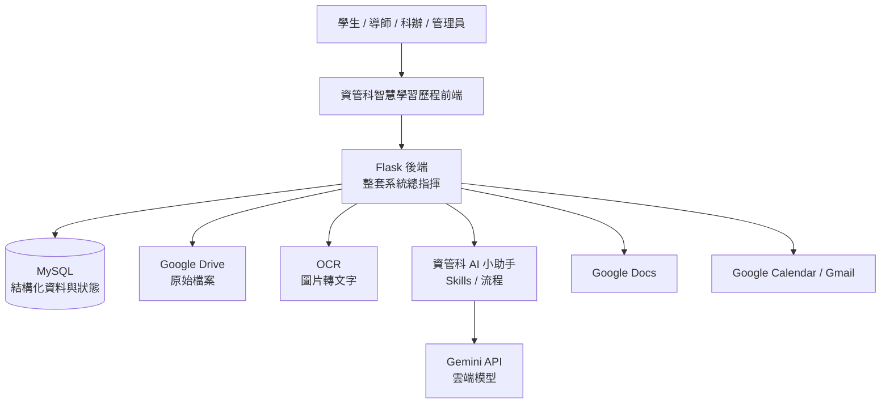

# 資管科智慧學習歷程系統－新規劃設計

> 文件類型：設計提案 / RFC（Request for Comments）  
> 用途：提供指導老師、組員討論「是否調整系統架構與開發方向」  
> 狀態：**提案中，尚未取代原成果報告書內容**  
> 核心原則：**Google 已經做得很好的功能不重做；本系統專心做 Google 不知道、也不會替學校處理的事情。**

---

# 0. 先講結論

這次不是把原本的「資管科智慧學習歷程系統」推倒重做，而是重新切清楚：

- **Google Drive / Docs / Sheets / Calendar / Gmail**：負責成熟的檔案、文件協作、試算表、行事曆與通知能力。
- **本系統前端**：負責五年學習歷程導引、學生操作流程、缺件提示、升學準備與老師工作台。
- **Flask 後端**：負責權限、流程、資料驗證、Google API 串接、OCR、AI 工作調度。
- **MySQL**：負責結構化資料、關聯、狀態、稽核紀錄，不把 Google Drive 當資料庫。
- **OCR**：負責把成績單、證照等圖片轉成文字。
- **資管科 AI 小助手**：只根據系統提供的真實資料進行整理、提醒、比對與自傳草稿生成，不直接擁有任意瀏覽學生雲端的權限，也不做最終行政決策。

一句話版本：

> **檔案交給 Google 保存，本系統負責知道這些資料「是誰的、屬於哪一年、代表什麼、缺什麼、能不能用在升學，以及接下來該做什麼」。**

---

# 1. 為什麼要改這個方向？

## 1.1 原本可能重複開發的部分

如果全部自己做，會需要自行處理：

- 檔案儲存
- 文件版本
- 文件線上編輯
- Excel / 試算表功能
- 檔案分享
- Email 通知
- 行事曆提醒
- 檔案復原
- 大量附件管理
- 權限分享介面

這些 Google Workspace 已經有成熟功能。

如果專題再花大量時間重做：

1. 開發時間會被基礎功能吃掉。
2. UI / 文件編輯體驗很難超過 Google Docs。
3. 老師反而可能直接拿 Google Docs、Drive 的成熟度比較。
4. 真正有差異的 OCR、AI、五年學習歷程導引、升學輔導反而做不完。

---

## 1.2 新方向的價值

本系統不要變成「另一個 Google Drive」。

本系統真正要解決的是 Google 不知道的事情：

- 這個檔案是哪一位學生的？
- 是專一、專二、專三、專四還是專五？
- 是哪一學期？
- 它是證照、競賽、成績、專題、實習還是作品？
- 這位學生現在缺什麼？
- 哪些資料可以用在二技備審？
- 哪一間學校需要哪些資料？
- 目前是否符合畢業或升學準備條件？
- 自傳裡寫的事情有沒有真實資料支持？
- 哪些內容應該由學生確認？
- 導師現在最需要先關心哪些學生？
- 下週有哪些專題、實習、升學的重要期限？

---

# 2. 新系統定位

## 2.1 新核心定位

> **「五年學習歷程導引與升學準備平台」**

不是單純：

> 檔案上傳平台

也不是：

> AI 自動寫作文平台

更不是：

> Google Drive 替代品

---

## 2.2 系統主要價值

### 對學生
- 五年資料持續整理，不到專五才臨時找。
- 知道每一年應該累積什麼。
- 成績單、證照等可透過 OCR 協助輸入。
- 系統知道哪些資料已完成、哪些還缺。
- 自傳可以根據自己的真實經歷與反思產生第一版草稿。
- 可以知道 AI 為什麼這樣寫。

### 對導師
- 不需要逐一問學生「做完了沒」。
- 可以看到班級準備狀況。
- 可以看學生送審的自傳版本。
- 可以留言、要求修改、確認完成。

### 對科辦 / 行政
- 管理公告、表單、證明、重要期限。
- 可以減少資訊散落在不同網站、LINE、Email 的問題。
- 可保留行政操作紀錄。

### 對學校
- 不必為了本專題重新開發完整文件協作平台。
- 正式導入時可使用既有 Google Workspace 能力。
- 核心程式集中在學校真正需要的流程與規則。

---

# 3. 使用者角色重新整理

## 3.1 V1 正式保留 4 類登入使用者

| 角色 | V1 工作 |
|---|---|
| 學生 | 五年資料管理、OCR 確認、升學準備、自傳產生與修改、送交導師 |
| 班導師 | 查看本班狀態、看送審自傳、留言、要求修改、確認完成 |
| 科辦 / 行政 | 公告、表單、證明、重要時程、行政資料 |
| 系統管理員 | 帳號、權限、系統規則、資料來源、Google 串接、AI 設定、稽核 |

---

## 3.2 不再把以下身分拆成獨立 V1 角色

- 沒帶班的專任教師
- 專題指導老師

原因：

如果他們目前沒有一套「和其他人明顯不同、且一定需要」的工作流程，就不應該為了角色名稱而增加整套權限與介面。

---

## 3.3 保留「教師－學生關係」擴充能力

資料庫可預留：

```text
teacher_student_relationship
- teacher_id
- student_id
- relationship_type
```

relationship_type 可以是：

```text
HOMEROOM_TEACHER
PROJECT_ADVISOR
COURSE_TEACHER
```

V1：

```text
只啟用 HOMEROOM_TEACHER
```

V2 真的有需求時再開其他關係。

---

# 4. 系統架構重新分工



---

# 5. 各元件白話版

| 元件 | 白話說法 |
|---|---|
| 前端 | 櫃台，學生和老師操作的地方 |
| Flask | 總管，決定現在要叫誰做什麼 |
| MySQL | 目錄＋帳本 |
| Google Drive | 倉庫，放真正的檔案 |
| OCR | 打字員，把圖片讀成文字 |
| AI 小助手 | 助理，根據整理好的資料給建議 |
| Gemini | 真正做大型語言模型運算的雲端服務 |
| Google Docs | 自傳正式協作編輯器 |
| Calendar / Gmail | 期限提醒與通知 |

---

# 6. Google Drive 到底負責什麼？

## 6.1 Google Drive 只負責保存檔案

例如：

- 證照 PNG / JPG / PDF
- 成績單掃描檔
- 競賽佐證
- 實習證明
- 專題附件
- 備審 PDF
- Google Docs 自傳

---

## 6.2 MySQL 不只存網址

錯誤方式：

```text
google_url = https://drive.google.com/...
```

比較好的方式：

```text
Portfolio_Items
- id
- student_id
- academic_year
- semester
- category
- title
- drive_file_id
- ocr_status
- confirmed
- status
- created_at
```

白話：

> Google Drive 知道「檔案在哪裡」。

> MySQL 知道「這個檔案是什麼」。

---

# 7. 現階段沒有學校 Workspace，怎麼辦？

## 7.1 專題原型階段

目前只有個人的學校 Google 帳號。

因此：

> **先用專題測試帳號的 My Drive 做 Google Drive API 整合原型。**

例如：

```text
資管科智慧學習歷程_專題測試
└─ demo-student-01
   ├─ 一年級
   ├─ 二年級
   ├─ 三年級
   ├─ 四年級
   └─ 五年級
```

---

## 7.2 正式學校導入階段

未來若取得學校 Google Workspace 管理配合：

```text
My Drive 測試儲存
        ↓
切換
        ↓
學校 Shared Drive
```

正式資料應由學校組織持有，不應長期綁在學生或開發者個人帳號。

---

## 7.3 報告時的正確說法

> 「目前專題階段尚未取得學校 Google Workspace 管理權限，因此先使用專題測試帳號的 My Drive 驗證 Google Drive API 整合流程。若未來正式導入，再由校方提供組織擁有的 Shared Drive 或其他正式儲存空間。」

---

# 8. Google 登入設計

## 8.1 不處理 Google 六位數驗證碼

本系統不自行讀取或保存 Google MFA / 六位數驗證碼。

流程：

```text
學生
↓
使用 Google 登入
↓
Google 自己做帳密 / Passkey / 2FA
↓
Google 驗證成功
↓
回傳 OAuth 授權結果
↓
Flask 驗證學校 Email 與系統帳號
↓
建立本系統 Session
```

---

# 9. 五年資料夾怎麼建立？

建議使用：

> **Lazy Provisioning（需要時才建立）**

不要第一次登入就一次建立幾十個空資料夾。

例如學生第一次上傳：

```text
專一上 / 證照
```

系統才建立：

```text
一年級
└─ 上學期
   └─ 證照
```

這可以降低程式複雜度與 Drive 垃圾資料。

---

# 10. 學生如果自己刪 Google Drive 怎麼辦？

這是一個正式產品必須處理的問題。

## 10.1 原則

> **學生主要透過本系統管理資料，不把整個 Google 儲存資料夾的管理權交給學生。**

---

## 10.2 最小權限

學生不應該取得整個儲存資料夾的高權限。

例如：

- 原始檔案：由系統保存
- 學生：透過網站查看、下載、申請刪除
- 自傳 Google Doc：才給學生編輯權
- 導師：Commenter 或 Reader

---

## 10.3 軟刪除

學生按「刪除」：

```text
status = DELETED
deleted_at = ...
deleted_by = ...
```

先不立刻永久刪除 Google Drive 原始檔。

例如保留 30 天：

```text
ACTIVE
↓
SOFT_DELETED
↓
30 天內可以復原
↓
PURGED
```

---

## 10.4 正式送審資料不可被學生破壞

自傳送交導師時：

```text
目前自傳
↓
建立 Submission Snapshot
↓
固定當時版本
↓
老師看的是送審版
```

學生後來修改的是新版，不會改到老師當時收到的版本。

---

# 11. OCR 整合流程

## 11.1 OCR 不負責判定對錯

OCR 只回答：

> 「圖片上看起來寫了什麼？」

例如：

```text
資料庫系統 3 87
網頁設計 2 92
會計學 3 78
```

---

## 11.2 OCR 後要三層確認

### 第一層：程式規則

例如：

- 成績 0～100
- 學分不得為負數
- 課程名稱不能空白
- 學期格式要正確

---

### 第二層：MySQL 規則資料比對

例如：

```text
Curriculum_Rules
- course_name
- credits
- required_type
```

OCR：

```text
資料庫統系
```

資料庫：

```text
資料庫系統
```

系統知道：

> 可能辨識錯。

---

### 第三層：AI 只做建議

AI 可以說：

> 「OCR 的『資料庫統系』可能是『資料庫系統』。」

但不直接改正式資料。

畫面：

```text
OCR：資料庫統系
AI 建議：資料庫系統

[確認] [修改]
```

學生確認後才成為正式資料。

---

# 12. 證照 OCR 與個資處理

原始證照可能包含：

- 姓名
- 身分識別資料
- 證書字號
- QR Code
- 條碼
- 日期
- 發證機構

自傳 AI 不需要看到全部內容。

---

## 12.1 建議流程

```text
原始證照圖片
↓
OCR
↓
後端欄位抽取
↓
去識別化
↓
學生確認
↓
MySQL
↓
AI 只讀必要欄位
```

---

## 12.2 例如原始 OCR

```text
姓名：王○○
證書字號：12345678
證照名稱：網頁設計丙級
發證單位：勞動部
發證日期：2026/06/15
```

送給 AI 的資料：

```text
證照名稱：網頁設計丙級
發證單位：勞動部
取得時間：專三
```

原始圖片仍在 Google Drive。

Gemini 不一定需要看到證照圖片。

---

# 13. AI 小助手怎麼「看」Google Drive？

不要說：

> AI 自己爬 Google Drive。

正確架構：

> **Flask 後端先查 MySQL，再依 Drive File ID 取得這次需要的檔案，整理之後才把必要資訊交給 AI。**

流程：

```text
學生提出問題
↓
Flask 查 student_id
↓
MySQL 找相關 Portfolio_Items
↓
取得 drive_file_id
↓
Drive API 取需要的檔案
↓
OCR / 文字整理
↓
去識別化
↓
交給 AI
```

AI 沒有「自由翻整個學生雲端」的權限。

---

# 14. 自傳到底怎麼產生？

## 14.1 不直接把所有資料丟給 AI

錯誤：

```text
Gemini，這是學生所有資料，幫我寫一篇漂亮自傳。
```

正確：

```text
真實學習證據
+
學生本人反思
+
學生本人語氣
+
目標校系
+
AI 負責整理
```

---

# 15. Evidence Package（自傳證據包）

Flask 先整理：

```text
目標：
資訊管理相關二技校系

Evidence 01
類型：證照
名稱：網頁設計丙級
取得時間：專三
來源：Portfolio_Item #18

Evidence 02
類型：專題
名稱：資管科智慧學習歷程系統
負責：需求規劃、前端
來源：Portfolio_Item #31

Evidence 03
類型：實習
來源：Internship_Record #8

Evidence 04
類型：學生反思
內容：
「一開始很怕寫程式，後來做專題開始覺得把東西做出來很有成就感。」
```

這份 Evidence Package 才送給 AI。

---

# 16. 避免自傳變成 AI 公版作文

只有成績、證照、競賽：

> 很容易生成很普通的自傳。

因此在「產生自傳」前，學生回答少量個人問題：

1. 五年最有成就感的是哪件事？
2. 有沒有一次做失敗後重新完成？
3. 為什麼想讀這個二技科系？
4. 哪件作品最像自己？為什麼？
5. 希望文章給人的感覺？
6. 哪些事情不希望 AI 寫進去？

也可以提供一小段學生自己寫的文字作為語氣參考。

原則：

> AI 可以整理語氣，不能創造不存在的人生經歷。

---

# 17. AI 產生自傳時要留下「可驗證依據」

不要只回：

```text
autobiography = 一整篇文章
```

建議：

```json
{
  "paragraph": "在五專期間，我逐漸……",
  "evidence_ids": [18, 31],
  "needs_confirmation": false
}
```

後端可以檢查：

- evidence_id 是否存在
- 是否真的屬於這名學生
- 是否引用了 AI 根本沒拿到的資料
- 是否有 unsupported claim

---

# 18. AI 判斷過程要不要顯示？

## 不顯示模型內部思考文字

不需要顯示：

> AI 腦內一步一步怎麼想。

真正應該顯示的是：

### 可驗證依據

```text
此段使用：
✓ 網頁設計丙級
✓ 專二網頁作品
✓ 專四畢業專題

學生本人補充：
「一開始不太敢寫程式……」

⚠ 尚未找到：
可以證明「團隊領導能力」的資料
```

---

# 19. AI 判斷依據放在哪裡？

## 19.1 產生前

先出現：

```text
準備用以下資料產生自傳

✓ 成績與課程
✓ 證照
✓ 競賽
✓ 專題
✓ 實習
✓ 學生反思
✓ 已允許使用的教師回饋

⚠ 尚未填：
未來生涯方向

[補資料] [開始產生自傳]
```

---

## 19.2 產生後

自傳編輯頁右側：

```text
AI 小助手・資料依據

這段使用：
✓ Evidence #18
✓ Evidence #31

[查看原始資料]
```

---

# 20. 如何降低 AI 幻覺？

## 20.1 不能宣稱 0 幻覺

以下說法不要再用：

> temperature = 0，所以 AI 不會幻覺。

Temperature 低只能降低隨機性，不代表內容一定正確。

---

## 20.2 用系統設計降低風險

```text
AI 草稿
↓
Evidence ID 驗證
↓
規則檢查
↓
標示沒有證據的內容
↓
學生確認
↓
老師確認
```

AI 永遠是：

> 草稿與建議

不是：

> 真實資料的最終裁判。

---

# 21. 教師評語怎麼用比較安全？

不建議把所有老師私下評語直接丟給 AI。

可以增加：

```text
可作為備審參考：YES / NO
```

老師可以只勾選：

- 做事細心
- 能完成分配工作
- 有責任感
- 溝通能力佳

或輸入一段：

> 「可提供學生備審使用的回饋。」

只有明確允許的內容才進 Evidence Package。

---

# 22. 自傳與 Google Docs 整合

V1 不必把完整 Google Docs 可編輯器硬塞進本系統。

流程：

```text
AI 完成自傳草稿
↓
系統建立 Google Docs
↓
學生 = Writer
班導 = Commenter
↓
學生按：
「在 Google Docs 編輯」
↓
老師可以留言
↓
學生回系統送審
```

---

# 23. 老師 Email 不讓學生自己填

資料庫：

```text
Students
- student_id
- class_id

Classes
- class_id
- advisor_teacher_id

Teachers
- teacher_id
- school_email
```

系統自動知道：

```text
學生
↓
班級
↓
班導
↓
班導 Email
```

因此可以自動把自傳分享給正確班導。

---

# 24. Google Sheets 怎麼用？

Google Sheets 可以當：

> **報表與分析工具**

例如：

- 班級升學目標
- 資料完成率
- 缺件名單
- 校系分布
- 統計圖表

但：

> **MySQL 才是正式資料來源。**

不要讓老師直接把 Google Sheets 當核心資料庫。

流程：

```text
MySQL
↓
統計服務
↓
Google Sheets
↓
老師自行 Filter / Pivot / Chart
```

---

# 25. 公告與 Calendar / Gmail

資管科 AI 小助手可以定期查看「管理員允許的公開資料來源」。

例如：

- 資管科官網
- 教務處公告
- 二技招生資訊
- 專題相關公告

流程：

```text
允許來源
↓
後端定期檢查
↓
找到新內容
↓
AI 分類 / 摘要
↓
候選公告
↓
管理員確認
↓
正式發布
↓
Calendar / Email / 系統通知
```

AI 不應該抓到就直接發布。

---

# 26. 真正需要 AI Server 嗎？

如果使用 Gemini API：

> **不需要自己架大型 GPU AI Server。**

本校伺服器主要跑：

- Flask
- MySQL
- 權限
- Google API
- OCR 工作
- 排程
- 工作佇列
- AI API 調度

真正的大型模型推論在 Google 雲端完成。

---

# 27. 正式多人使用需要什麼？

如果很多學生同時按：

> 產生自傳

不要讓 Web Request 一直卡著。

正式版本可增加：

```text
Flask
↓
Job Queue
↓
Background Worker
↓
Gemini API
↓
完成後通知學生
```

例如：

- Redis
- Celery / RQ

這仍然不代表需要 GPU。

---

# 28. 資安原則

## 28.1 最小權限

- AI 不直接瀏覽全部 Drive。
- 學生不管理整個儲存資料夾。
- 導師只能看到自己有關係的學生。
- 科辦只看行政需要內容。
- 管理員操作有 Audit Log。

---

## 28.2 資料最小化

AI 任務只拿：

> 完成這個任務真正需要的欄位。

不必要資料：

- 姓名
- 學號
- 身分識別資料
- 證書字號
- 私人老師評語

原則上不要送。

---

## 28.3 人工確認

以下都不能只靠 AI 決定：

- OCR 正式資料
- 學分資格
- 證照資格
- 行政核准
- 自傳正式送審
- 招生規則正式發布

---

# 29. V1 現在一定要完成什麼？

這是這次架構調整最大的目的：

> **砍掉重複開發，保住核心。**

## V1 MUST

1. 學生 / 班導 / 科辦 / 管理員基本角色。
2. 學生五年任務式前端。
3. MySQL 結構化學習歷程。
4. Google Drive API 原型。
5. 成績單 OCR。
6. OCR → 規則比對 → 學生確認。
7. 證照 / 成績等學習證據分類。
8. AI 小助手基本 Skills。
9. Evidence Package。
10. 有依據的自傳草稿。
11. 自傳 Google Docs 建立 / 分享班導。
12. 基本公告與提醒。
13. 操作紀錄與人工確認。

---

# 30. V1 可以直接砍掉什麼？

為了提高開發效率，V1 不重做：

- 自己的線上文件編輯器
- 自己的 Google Drive
- 自己的 Excel
- 自己的 Email 系統
- 自己的 Calendar
- 複雜的專任教師 / 指導老師權限
- AI 任意瀏覽全部 Drive
- AI 自動做行政決策
- 大量動畫與非核心美化
- 一次建立所有年級所有資料夾
- 自己架大型語言模型 GPU Server

---

# 31. V2 再做什麼？

- 正式 Shared Drive
- Google Workspace SSO
- 專任教師 / 指導老師關係
- 更細的教師 Evidence
- Google Workspace Add-on
- 更完整班級 Sheets Dashboard
- AI 招生規則年度更新
- 背景工作系統
- 更完整通知中心
- 企業級 AI / Zero Data Retention 規格
- 多校 / 多租戶架構

---

# 32. 最小 Demo 主線

開會時不要展示 50 個功能。

只展示一條完整故事：

```text
學生 Google 登入
↓
進入五年學習歷程
↓
上傳成績單
↓
OCR
↓
學生確認
↓
上傳證照
↓
Google Drive 自動存放
↓
MySQL 建立 Portfolio Item
↓
系統顯示目前缺件
↓
專五按「產生自傳」
↓
學生確認 AI 會使用哪些資料
↓
AI 根據 Evidence + 學生反思寫草稿
↓
每段都能看資料依據
↓
建立 Google Docs
↓
自動分享班導
↓
班導留言
↓
學生修改後送審
↓
固定 Submission Snapshot
```

如果這條跑得完整，就比很多「功能很多但彼此沒接起來」的專題強。

---

# 33. 怎麼證明這次改架構真的提高開發效率？

## 原方案

自己開發：

```text
檔案管理
文件編輯
版本管理
分享
通知
行事曆
報表
OCR
AI
升學
學習歷程
```

## 新方案

Google 負責：

```text
Drive
Docs
Sheets
Calendar
Gmail
```

我們集中：

```text
五年導引
OCR
資料結構化
升學規則
Evidence
AI Skills
自傳
老師確認流程
```

開發資源可以從「重做成熟工具」轉移到：

> **專題真正有差異的核心功能。**

---

# 34. 跟指導老師開會時，軟體業通常怎麼呈現這種「突然想到的新架構」？

這種情況不要直接把程式改掉。

軟體業比較像會先提出：

> **Design Proposal / RFC / Architecture Change Proposal**

也就是：

> 「我想到一個可能更好的方法，先拿設計文件出來讓大家 Review，確認值得做才改。」

---

# 35. 會議報告建議順序

## 第 1 張：目前遇到的問題

不要先講 Google API。

先講：

> 「我們目前花大量時間自行開發檔案、文件與資料管理功能，但這些功能 Google 已經非常成熟，導致我們真正的 OCR、AI 與五年導引反而可能做不完。」

---

## 第 2 張：新的 Insight

只放一句：

> **Google 已經把『工具』做好了，我們應該專心做 Google 不知道的『學生五年學習脈絡與升學規則』。**

---

## 第 3 張：Before / After

### Before

```text
我們的系統
= Drive + Docs + Excel + AI + OCR + 升學 + 學習歷程
```

### After

```text
Google
= Drive + Docs + Sheets + Calendar + Gmail

我們
= 五年歷程 + OCR + AI + Evidence + 升學 + 輔導流程
```

---

## 第 4 張：新架構圖

直接用本文件第 4 節 Mermaid 架構。

---

## 第 5 張：學生完整故事

展示：

```text
上傳成績單
→ OCR
→ 確認
→ 累積五年
→ Evidence
→ AI 自傳
→ Google Docs
→ 導師確認
```

---

## 第 6 張：AI 不亂寫

說三件事：

1. AI 只收到 Evidence Package。
2. 不必要個資先去識別化。
3. 重要句子保留 Evidence ID，學生與老師可確認。

---

## 第 7 張：開發效率

列出：

### 不再自己做
- Drive
- Docs editor
- Excel
- Mail
- Calendar

### 我們集中做
- OCR
- AI Skills
- 五年資料
- 升學
- 導師流程

---

## 第 8 張：限制

一定主動講：

- 目前沒有 Workspace Admin。
- 專題先用測試 My Drive。
- Shared Drive 是正式導入條件。
- AI 不保證零幻覺。
- 真實個資正式上線前仍需校方資安規範。

主動講限制，老師反而比較難抓你「假裝全部都能做」。

---

## 第 9 張：需要老師決策的問題

不要會議講完什麼都沒有結論。

直接請老師確認：

1. 是否同意 V1 教師角色只保留班導？
2. 是否同意 Google Drive / Docs 作為外部成熟服務，不再自行開發？
3. 是否同意專題原型先使用測試帳號 My Drive？
4. 是否同意 AI 自傳定位為「有依據的草稿助手」？
5. 是否同意把 Shared Drive、Workspace SSO 列正式導入 / V2？
6. 哪些原本功能應該直接取消，確保進度？

---

# 36. 口頭報告開場範例

可以這樣講：

> 「我們最近在開發時遇到一個問題：如果我們自己繼續做檔案管理、文件編輯、試算表和通知，等於花很多時間重做 Google 已經非常成熟的功能，但我們真正有特色的 OCR、五年學習歷程和 AI 小助手反而會被拖慢。所以我們想提出一次架構調整，不是把系統變成 Google Drive，而是把 Google 當底層工具，我們專心處理 Google 不知道的學生五年脈絡、缺件、升學與 AI 輔導。」

接著再展示：

> Before / After。

---

# 37. 老師可能追問與回答

## Q：那這樣不就是 Google Drive？

A：

> 「不是。Google Drive 只負責保存檔案；它不知道檔案是哪一學年、哪一類學習成果，也不知道學生缺什麼、能不能拿去準備某個二技校系。我們的價值是在這些結構、規則與輔導流程。」

---

## Q：學生把檔案刪了怎麼辦？

A：

> 「學生不取得整個儲存資料夾的管理權。系統內刪除採軟刪除，正式送審還會固定一份 Submission Snapshot，因此不會因為學生改 Draft 就破壞老師已經收到的版本。」

---

## Q：AI 怎麼讀 Google Drive？

A：

> 「AI 不直接爬 Drive。Flask 先查 MySQL，再依 Drive File ID 讀取這次任務需要的檔案，去識別化與整理後才交給 AI。」

---

## Q：OCR 認錯怎麼辦？

A：

> 「OCR 只讀文字，後端會先用數值規則與修業科目表比對；AI 只能提出可能修正，最後由學生確認後才寫入正式資料。」

---

## Q：AI 自傳是不是會亂寫？

A：

> 「不能保證模型完全沒有幻覺，所以我們不是靠 Prompt 保證，而是用 Evidence Package、Evidence ID、後端驗證、學生確認和導師確認降低風險。」

---

## Q：AI 會不會看到太多個資？

A：

> 「不必要個資不送 AI。像證照先 OCR，抽出證照名稱、發證單位、取得時間等必要欄位後再使用，原始證照留在 Drive。」

---

## Q：需要買 AI Server 嗎？

A：

> 「如果使用 Gemini API，大型模型推論在 Google 雲端，學校伺服器主要負責 Flask、MySQL、權限、OCR、API 與工作調度，不需要為模型另外買 GPU 主機。」

---

## Q：現在沒有 Workspace 怎麼 Demo？

A：

> 「原型先使用測試帳號 My Drive；Shared Drive 與正式 Workspace SSO 列為正式導入需求，不假裝目前已取得校方權限。」

---

# 38. 會議要追求的不是「老師覺得好酷」

這場會議真正要得到：

```text
DECISION 1
V1 教師角色是否只留班導？

DECISION 2
是否正式採 Google Drive / Docs 整合方向？

DECISION 3
原本哪些功能停止自行開發？

DECISION 4
哪些功能進 V1 / V2？

DECISION 5
下一個兩週 Sprint 要完成什麼？
```

沒有 Decision 的會議很容易變成聊天。

---

# 39. 建議會後立即形成 Decision Log

例如：

```text
ADR-001
決策：
專題 V1 使用 Google My Drive 作為 API 整合原型。

原因：
目前無學校 Workspace 管理權。

正式方案：
Shared Drive。

狀態：
Approved / Rejected / Needs revision
```

下一個：

```text
ADR-002
決策：
V1 教師端只實作班導。

原因：
目前備審主線只有班導有明確工作流程。

V2：
專任教師、指導老師關係。
```

這就是比較像軟體團隊的工作方式。

---

# 40. 建議下一步

## Step 1：先不要改成果報告書

先讓：

- 指導老師
- 三位組員

Review 本文件。

---

## Step 2：會議拍板 V1 / V2

把「一定做」與「先不做」定案。

---

## Step 3：做 Technical Spike

只測最關鍵的技術可行性：

1. Google OAuth 能不能登入？
2. Drive API 能不能建立資料夾？
3. Drive API 能不能上傳測試檔？
4. 能不能存回 drive_file_id？
5. OCR 能不能讀一張測試成績單？
6. Gemini 能不能只根據 Evidence JSON 產生一小段可追溯文字？

只要這六件成功，新的核心架構基本上就成立。

---

## Step 4：再修改正式規格書

等老師同意後再去改：

- 使用者角色
- 系統架構圖
- 功能需求
- ERD
- 資料流程
- AI 限制
- Google API
- OCR
- 資安
- V1 / V2 Scope

不要先改一大堆文件，結果老師最後不同意方向。

---

# 41. 最終產品一句話

> **把五年散落的作品、證照、成績、專題與實習整理成可以被理解、被驗證、被再利用的學習證據，並在升學需要時，讓 AI 根據學生真正留下的資料協助完成備審準備。**

---

# 42. 這次架構調整的真正目的

不是：

> 「因為做不完，所以偷懶接 Google。」

而是：

> **「不要花有限的開發時間重做成熟工具，把時間集中到只有我們這套系統才需要懂的五專五年學習與升學流程。」**

這就是這次設計變更最重要的理由。
